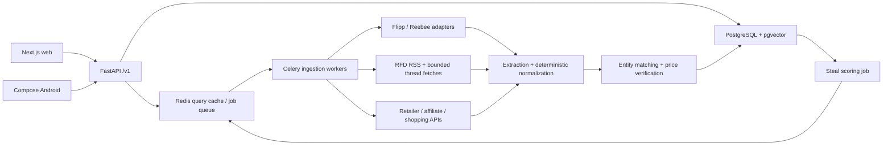

# DealRadar CA — architecture and product plan

## Product direction

Help Canadians find the lowest comparable local price and decide whether a deal
is worth buying. Lead with real savings, clear conditions, freshness, and useful
unit prices. Launch in Windsor/Essex, then expand province by province as source
coverage is proven. Prices and examples in this starter are illustrative; no
live integration or retailer partnership has been validated.

**Implementation update:** the repository now contains FastAPI routes, bounded
Flipp/RFD orchestration, source status, deterministic package parsing,
SQLite/PostgreSQL API read-model storage, optional Redis caching, WebSocket
snapshot events, an exported OpenAPI contract, and a Kotlin Compose client.
See `README.md` and `VERIFICATION.md` for actual checks and execution limits.
The design below also covers follow-on pgvector matching, distributed workers,
account sync, and licensed retailer verification, which are not implemented yet.

Choose Next.js 14+ App Router, TypeScript, Tailwind, and Shadcn/UI for responsive
web; Kotlin Jetpack Compose with Retrofit/OkHttp for native Android. Share the
OpenAPI contract, not UI code. Use Python FastAPI for orchestration and ingestion,
PostgreSQL 15+ with pgvector, Redis, and Celery workers. Start as a modular backend
with separate API and worker processes rather than independent microservices.

## System architecture



Persist raw provenance first. Pipeline: discover → deduplicate → extract →
normalize → match → verify → publish. Every stage is idempotent and versioned.
API searches the indexed catalog immediately and queues missing/stale coverage.
Do not block each search on a fan-out to all external sites. Return partial
coverage and source freshness; optionally send progress over WebSocket.

## Localization and cache policy

Accept full Canadian postal codes or three-character FSAs (the first three
characters, not three digits). Normalize case/spacing and validate format.
FSA-only input selects approximate circular coverage; ask for a full postal code
or store selection when provider coverage differs within that FSA.

Cache regional flyer inventories as
`flyer:v1:{provider}:{fsa}:{coverage_variant}:{locale}:{week}` for 21,600 seconds.
Use provider-confirmed store/circular variants. Search slices add a normalized
query hash. Until equivalent coverage is validated, include the supplied postal
code in the variant to avoid incorrectly sharing local prices. E-commerce prices
use store/location-specific caches, initially 5–15 minutes. Cap offer freshness at
its expiry; Redis TTL does not extend a deal. Track fetched_at separately from
verified_at, invalidate after price changes, and single-flight identical requests.

Never convert an FSA to a fictitious full postal code. For ambiguous geographic
queries such as “near Windsor,” resolve against a Canadian locality table and
present the chosen location. An explicit postal selection controls circulars.
Store timestamps in UTC; retain the circular's IANA timezone and local date
boundaries (inclusive end date becomes next local midnight). Canada spans
multiple timezones; do not assume Toronto for every deal.

## Source extraction and verification

### Flipp and Reebee

`scrapers/flipp_client.py` demonstrates a historically used public search endpoint
and maps title, retailer, sale/regular price, flyer ID, image, polygon, and dates
when present. Its URL, response fields, FSA support, and availability are
unverified here and may change. Pin recorded fixtures and schema checks before
enabling production. Fail visibly on unexpected schemas; do not manufacture
missing prices or clipping URLs. Fetch circular detail only when needed to resolve
thumbnail/polygon fields; persist the provider's actual deep-link.

Keep Reebee behind the same adapter contract, but implement only after validating
an authorized endpoint and mapping. Do not assume Flipp's schema or GraphQL route
applies to Reebee. Prefer licensed feeds. Honour rate limits and access controls;
do not circumvent authentication, CAPTCHAs, or site restrictions.

### RedFlagDeals

Read `/rss/feed/active/` for discovery. The active feed is not guaranteed to be
exclusively Hot Deals: production must validate forum/category membership before
promoting a thread. Fetch a bounded set of permitted thread pages, extracting
retailer tag, title, thread URL, score, separate votes if actually exposed, and
the first-post deal link. Selectors in the starter are illustrative and need
fixture validation. Missing votes are unknown, never zero. RSS publication is
not an expiry date. Scan pending candidates on a schedule to detect vote velocity;
the starter's bounded feed sample is not a complete trending index.

Use score >20 for ingestion and >25 for community-hot eligibility. A score field
does not reveal separate upvote/downvote counts. Keep the community thread link
alongside the verified retailer link. Resolve redirect links only through a
retailer host allowlist, rejecting private IPs and revalidating each redirect.

### PC Express / PC Optimum and Walmart Canada

Prefer authorized catalog/affiliate APIs, then permitted structured product data.
Select the exact pickup store and fulfillment mode before checking PC Express
prices; Walmart availability must also use location, seller, and fulfillment.
Verify SKU/GTIN, model/size, stock, CAD price, sale dates, and purchase conditions
against a current retailer source. Grocery prices by weight may be estimates.

PC Optimum offers can be personalized: keep bonus points, member-only prices,
minimum spend, quantities, and redemption assumptions separate from cash price.
Do not access private loyalty accounts without a later user-authorized integration.
Costco membership, Amazon third-party sellers, shipping, deposits, eco fees, and
taxes can change the cheapest choice. Show merchandise price and estimated landed
price separately; tax handling depends on province and product category.

SerpApi Shopping is a discovery source (`gl=ca`, `hl=en`, CAD where supported),
not proof of retailer checkout price. Never silently treat a US result as CAD.

## Normalization and product matching

Use a currently supported structured-output LLM selected through configuration;
do not hard-code an old model lifecycle. `services/deal_normalizer.py` provides
the prompt, schema, injectable asynchronous provider callback, and parser.
Send only raw product text, not user location or identity. Treat scraped content
as data. Validate strict JSON, quantity evidence, bounded values, and confidence.
The starter checks literal evidence; production must additionally validate that
evidence supports the parsed numerical quantity with category-specific parsers.

Compute with Decimal: `CAD/100g = sale_price * 100 / total_grams`;
`CAD/roll = sale_price / physical_roll_count`. Convert lb using 453.59237 g.
Never convert volume to mass without verified density. Preserve sheets, ply,
sheet area, and physical roll count for paper products; “mega roll” is not a
standard equivalence. Compare cost per 100 sheets when counts are available.
Null quantities produce null unit prices and require review. Round only for
display; retain precision for ranking. Confidence is a heuristic until calibrated
against a labelled validation set; extraction confidence is not price verification.

Match in stages: exact GTIN → brand/model/variant constraints → text and vector
candidate retrieval → reranking. Embeddings discover candidates; they must never
override hockey helmet size, device generation, multipack size, fresh/frozen,
boneless/bone-in, or refurbished/new distinctions. Embed product descriptions,
not changing prices; fix model/version and dimensionality (schema uses 768).
Partition comparison groups by compatible product and unit basis. Never sort
$/roll against $/100g. Include relevant alternatives in a separate group.

## Steal ranking and claims

Eligibility: active locally applicable offer with verified price, adequate exact
match confidence, and either ≥35% discount against a documented reference or an
RFD score >25. Trending unverified offers can appear under “Community finds,”
not “Today's Verified Steals.” Unknown expiry or stock needs explicit handling.

Discount = `(reference - sale) / reference`; reference must be positive.
Reference type and source are shown: MSRP, retailer regular, or observed historical
median. Score candidates using discount, evidence freshness, vote velocity,
historical percentile, availability, and verification confidence. Initial weights
are experimental and should be validated on a labelled set. Deduplicate by
product/retailer/region and cap repeated categories.

“Historical low” means lowest observed comparable price in a labelled window
(initially 90 days), with a minimum observation/day coverage requirement, not an
all-time guarantee. “Steal of the Week” uses the same evidence gate with a weekly
window. “Price error / flash sale” requires explicit source evidence; discount
alone cannot establish an error. Never imply the merchant will honour it.

## PostgreSQL model

Executable starter schema: `db/schema.sql`. `items` represents product variants;
`stores` and `store_locations` separate chains from branches. `offers` is the
common price/provenance table. `flyer_deals` extends it with circular geometry
and clipping metadata. `rfd_posts` preserves community evidence separately.
`price_observations` supports historical comparisons by item, region, conditions,
and location. Offer identity includes source ID, retailer, FSA, and location.

Follow-on migrations: users, consent, saved_lists, list_items, watches,
notification_preferences, source_runs, ingestion_failures, and vote_snapshots.
Retention policies should minimize exact postal codes; offer-region data can be
stored independently of a user's profile.

## REST and WebSocket contract

All routes use `/v1`; money is decimal strings, currency is CAD, timestamps are
ISO 8601, IDs are UUIDs, and nullable facts remain null. Publish FastAPI OpenAPI
and generate TypeScript/Kotlin clients. The table below is the broader design
contract. Implemented routes consistently use `postal_code`, accepting an FSA
as its value, rather than proposed `fsa` query parameters. The generated
`contracts/openapi.json` is authoritative for implemented request/response shapes.

| Endpoint | Contract |
|---|---|
| `GET /locations/resolve?postal_code=N9V` | FSA, approximate coverage, candidate stores, timezone, full-code requirement |
| `POST /search` | `{query,postal_code,store_ids?,locale?,cursor?}` → comparison groups, offers, coverage, freshness, `search_id`, `pending_sources` |
| `GET /deals/top?fsa=N9V&period=day` | Eligible steals; explicit verified/reference evidence and dates |
| `GET /items/{id}/offers?fsa=N9V` | Compatible unit basis, ranked comparable offers and conditions |
| `GET /items/{id}/history?fsa=N9V&days=90` | Observations, coverage, reference basis; no invented missing points |
| `GET /offers/{id}` | Price, conditions, store, source links, evidence, validity and verification |
| `GET /sources/status?fsa=N9V` | Coverage and last successful ingestion, source outages |
| `POST /watches` | Authenticated `{item_id,fsa,target_unit_price,unit_basis}`; opt-in alert preferences |
| `DELETE /watches/{id}` | Authenticated owner removes watch |
| `POST /lists` | Authenticated list creation; prices attach to later quotes |
| `POST /basket/quote` | Item quantities and store constraints → estimated totals, missing items, expiry |
| `WS /searches/{search_id}/events` | Scoped connection token; `source_completed`, `results_updated`, `search_finished` |

Example search offer:

```json
{"id":"<uuid>","product_name":"Chicken breast, boneless","store":"Example grocer",
 "sale_price":"11.00","regular_price":null,"unit_price":"1.1000",
 "unit_basis":"100g","currency":"CAD","source":"flipp",
 "match_kind":"category","conditions":[],"price_verified":false,
 "source_url":"<provider URL>","valid_to":null}
```

Use 422 for invalid query/location, 429 with Retry-After for limits, 503 when all
sources fail. Successful partial results include a coverage warning; an outage
must not masquerade as “no deals.” Cap query length, jobs per user, and pagination.
Use stable cursors and expire search event tokens. Public browse needs no account;
identity is required only for syncing lists, watches, and personalized alerts.

## Responsive product experience

Home: visible postal selector → verified steals → natural language search →
comparison groups → saved list. Steal cards show price, savings basis, local
validity, source, and verification time. Search accepts intent but displays parsed
filters for correction. Matrix columns: store, product match, sale price, regular
price, unit price, validity/source, and real outbound link. Unknowns show “—”.
Mobile uses labelled cards or a horizontal table with accessible headings.

`components/DealRadar.tsx` is a reusable Next.js/Tailwind starter for those flows,
with supplied offer data, local search, FSA selection, saving, and unit sorting.
It is not connected to live ingestion. Use Shadcn Dialog/Select/Card when adding
the app shell. Android mirrors these flows with Compose and the same API.

## Positive additions

1. **Basket savings:** compare a whole shopping list, including travel distance,
   stock gaps, and store-count limits. Show when a second stop saves too little.
2. **Buy-or-wait guidance:** explain observed history and confidence without
   urgency timers. Track items the user already intends to buy.
3. **Quiet price alerts:** opt-in target prices, daily digest, quiet hours, and
   one-tap unsubscribe; no repetitive “deal ending” notifications.
4. **Budget and waste controls:** weekly spending targets, freezer/storage notes,
   and “only show sizes I can use.” A bulk pack is not always a better purchase.
5. **Trust tools:** report incorrect prices, expired offers, wrong locations,
   accessibility issues, and retailer honouring problems; show correction status.
6. **Canadian accessibility:** English/French UI, CAD everywhere, WCAG 2.2 AA,
   screen-reader labels, keyboard support, and reduced-motion support.
7. **Transparent monetization:** labelled affiliate links with ranking independent
   of commission. Explain the reference price and membership conditions.
8. **Privacy-first browsing:** use FSA by default, no mandatory account, explicit
   location consent, export/delete controls, and no sale of location history.

## Delivery roadmap and operations

**Phase 0 — source feasibility:** confirm permitted integrations, postal coverage,
schema fixtures, and actual dates/votes; build a labelled size/matching dataset.
Acceptance: no unverified endpoint is described as production-ready.

**Phase 1 — Windsor/Essex MVP:** one flyer source, two verified retailers, RFD
discovery, unit comparison, top steals, and provenance. Start with groceries and
household essentials; handle sporting goods/electronics exact variants separately.
Acceptance: wrong-unit comparisons blocked, expired deals hidden, partial-source
outages explained, Canadian mobile flow usable without an account.

**Phase 2 — personal tools and Android:** watchlists, history, basket quotes,
Compose app, opt-in push notifications, offline saved lists with stale labels.

**Phase 3 — national rollout:** Quebec/French, additional provinces, source
licensing, category expansion, barcode lookup, receipt-based savings tracking
with explicit consent, and calibrated confidence.

Deploy API/worker containers and managed Postgres/Redis in an appropriate Canadian
region where available. Secrets stay server-side. Bound HTTP timeouts, retries,
LLM spend, worker concurrency, and host-specific request rates. Use dead-letter
queues and per-source circuit breakers. Track stale offers, coverage, parser
failures, normalized quantity accuracy, exact-match precision, API latency, and
cost per refresh. Initial targets: cached search p95 <800 ms, no invalid unit
ranking, and source freshness SLOs defined per provider. These are targets, not
measured results. Maintain backups and restore drills.

Before launch, validate source terms, attribution and Canadian privacy obligations
for the actual data collected. Test fixtures on every scraper release; integration
smoke tests require live permitted endpoints and credentials. Deploy staging first;
enable source adapters individually so a broken source cannot corrupt the catalog.
